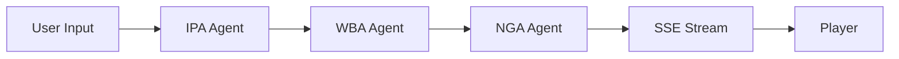

# Phase 3: Continuous AI & Agentic Automation Plan

**Date:** 2026-03-06
**Author:** Staff Agentic Architect (Copilot Agent)
**Status:** PLAN — Awaiting Review
**Prerequisite:** Phase 2 Remediation COMPLETE (0 ruff errors, 0 pyright errors, 1428 unit tests green)

---

## Executive Summary

TTA's CI is green and its core architecture (FastAPI, Neo4j, Redis) is stable.
Phase 3 introduces an automated multi-agent ecosystem that **prevents** future
technical debt rather than remediating it after the fact.

The plan delivers two categories of artifacts:

| Category | Location | Purpose |
|---|---|---|
| **Custom Agents** | `.github/agents/` | Specialized personas with hard boundaries |
| **Agentic Workflows** | `.github/workflows/` (Markdown) | Scheduled and event-driven automations |

> **Critical Constraint:** This plan does NOT modify any application code in
> `src/`, add new CI YAML workflows, or create agent/workflow files.
> It is a design document only.

---

## 1. Current State Assessment

### 1.1 Existing Agent Infrastructure

TTA already has a mature agent instruction layer:

| Layer | Files | Purpose |
|---|---|---|
| Root agent configs | `CLAUDE.md`, `AGENTS.md`, `GEMINI.md` | Per-agent root instructions |
| Copilot instructions | `.github/copilot-instructions.md` | IDE-level Copilot behavior |
| Modular instructions | `.github/instructions/*.instructions.md` (14 files) | Domain-scoped guidance (safety, testing, API, etc.) |
| Chat modes | `.github/chatmodes/*.chatmode.md` (15 files) | Role-based personas (architect, QA, DevOps, etc.) |
| Workflow templates | `.github/workflow-templates/` (3 files) | Reusable CI template patterns |

**What's missing:** Dedicated *autonomous* agent personas that can be invoked by
GitHub Copilot Coding Agent in CI/CD contexts with strict file-system boundaries,
executable commands, and "never do" guardrails.

### 1.2 Existing CI Workflows (6 total — do not expand without justification)

| Workflow | File | Trigger |
|---|---|---|
| Tests | `tests.yml` | push/PR to main, staging, development |
| Code Quality | `code-quality.yml` | push/PR |
| Coverage | `coverage.yml` | push/PR to main, staging |
| Security Scan | `security-scan.yml` | push/PR + daily schedule |
| CodeQL | `codeql.yml` | push/PR |
| Python 3.14 Compat | `python314-compat.yml` | push/PR |

> The suite was deliberately reduced from 35 to 6 (per `CLAUDE.md` Strict
> Boundary #8). Phase 3 adds **zero** new YAML workflow files. Instead, we use
> Markdown-based agentic workflow definitions that GitHub Copilot Coding Agent
> can follow as runbooks.

### 1.3 Quality Gate Baseline

```
uv run ruff check src/          → 0 errors
uv run ruff format --check src/ → 0 reformats needed
uv run pyright src/              → 0 errors, 0 warnings
uv run pytest tests/unit/ -q     → 1428 passed (~68s)
```

---

## 2. Custom Agents Design (`.github/agents/`)

### 2.1 Design Principles

Each agent file follows a consistent structure inspired by industry best
practices for agentic coding assistants:

```markdown
# @<agent-name>

## Identity
One-sentence role description.

## Activation
When this agent is invoked and by whom.

## Tools & Commands
Executable commands the agent MUST run (listed first, before prose).

## Boundaries
### MUST
- Hard requirements the agent always follows.
### NEVER
- Explicit prohibitions that prevent scope creep.

## File Scope
Exact glob patterns for files the agent may read/write.

## Examples
Concrete before/after code examples demonstrating expected behavior.

## Escalation
When to stop and ask for human review.
```

**Why this structure matters:**
- **Commands early:** Agents perform better when executable actions appear
  before prose explanations.
- **Explicit "NEVER" boundaries:** Prevents hallucinated scope creep (e.g., a
  lint agent "helpfully" refactoring business logic).
- **File scope globs:** Enables future enforcement via CODEOWNERS or CI checks.
- **Escalation policy:** Every agent knows when to stop.

---

### 2.2 `@test-agent` — Test Quality Guardian

**File:** `.github/agents/test-agent.md`

#### Identity

Specialized pytest agent responsible for maintaining and expanding the TTA test
suite. Focused on coverage gaps, flaky test detection, and test quality.

#### Tools & Commands

```bash
# Quality gate (run first, always)
uv run pytest -q --tb=short \
  -m "not integration and not neo4j and not redis" \
  tests/unit/ tests/monitoring/ tests/security/ tests/player_experience/ tests/common/

# Coverage analysis
uv run pytest --cov=src --cov-report=term-missing --cov-fail-under=0 tests/unit/

# Flaky test detection (run suspect tests 5x)
uv run pytest --count=5 -x <test_file>::<test_name>

# Unused fixture detection
uv run pytest --unused-fixtures tests/unit/

# Profile slow tests
uv run pytest --profile tests/unit/
```

#### Boundaries

| MUST | NEVER |
|---|---|
| Follow AAA (Arrange-Act-Assert) pattern | Remove or skip failing tests (unless `@pytest.mark.quarantine`) |
| Use existing markers: `@pytest.mark.redis`, `neo4j`, `integration` | Modify files under `src/` — only `tests/` and `conftest.py` |
| Use `tests/fakes/` (FakeRepository, FakeUnitOfWork) for isolation | Add new pytest plugins without justification |
| Maintain async test pattern: `@pytest.mark.asyncio` with `asyncio_mode = "auto"` | Create tests that depend on execution order |
| Use `tests/helpers/retry.py` (retry_with_backoff, wait_until) instead of `time.sleep` | Import `torch`, `transformers`, or GPU deps in unit tests |
| Write to `tests/unit/`, `tests/integration/`, `tests/e2e/` only | Write to `docs/`, `.github/workflows/`, or `src/` |

#### File Scope

```
tests/**/*.py          # Read + Write
conftest.py            # Read + Write
tests/conftest.py      # Read + Write
tests/fakes/**/*.py    # Read only (use, don't modify)
tests/helpers/**/*.py  # Read only (use, don't modify)
src/**/*.py            # Read only (understand code under test)
pyproject.toml         # Read only (understand markers, config)
```

#### Examples

```python
# ✅ GOOD: AAA pattern with FakeRepository
from tests.fakes import FakeRepository, FakeUnitOfWork

def test_player_creation_stores_player():
    # Arrange
    repo = FakeRepository()
    uow = FakeUnitOfWork(repo)
    service = PlayerService(uow)

    # Act
    player = service.create("test-player")

    # Assert
    assert repo.get(player.id) is not None
    assert player.name == "test-player"


# ❌ BAD: No assertions, modifies src/
def test_something():
    import src.models  # Don't import src in test agent scope
    src.models.Player.name = "hacked"  # NEVER modify src/
```

#### Escalation

- If a test fails and the root cause is in `src/` business logic → stop and
  report the failing test + suspected root cause. Do NOT fix `src/` code.
- If coverage drops below 70% after changes → flag for human review.
- If more than 3 tests are flaky in the same module → open an issue, don't
  auto-fix.

---

### 2.3 `@docs-agent` — Documentation Keeper

**File:** `.github/agents/docs-agent.md`

#### Identity

Specialized mkdocs documentation agent responsible for keeping architecture
docs, API references, and developer guides aligned with the codebase.

#### Tools & Commands

```bash
# Build docs locally (verify no broken links)
uv run mkdocs build --strict 2>&1 | head -100

# Serve docs for preview
uv run mkdocs serve --dev-addr 127.0.0.1:8001

# Check for orphaned docs (files not in mkdocs.yml nav)
diff <(find docs/ -name '*.md' | sort) \
     <(grep -oP '(?<=: )[\w/.-]+\.md' mkdocs.yml | sed 's|^|docs/|' | sort)

# Validate internal links
uv run mkdocs build --strict 2>&1 | grep -i "warning\|error"
```

#### Boundaries

| MUST | NEVER |
|---|---|
| Write Markdown files in `docs/` only | Modify any file under `src/` |
| Update `mkdocs.yml` nav when adding new pages | Modify `.github/workflows/*.yml` |
| Use Google-style docstring references from source | Create new CI workflows |
| Include Mermaid diagrams for architecture changes | Remove existing documentation without explicit approval |
| Follow existing doc structure: `docs/{architecture,development,packages,deployment}/` | Expose secrets, credentials, or internal URLs in docs |
| Cross-reference with `ARCHITECTURE.md` and `README.md` | Change `pyproject.toml` or any Python config |

#### File Scope

```
docs/**/*.md           # Read + Write
mkdocs.yml             # Read + Write (nav updates only)
README.md              # Read + Write
ARCHITECTURE.md        # Read + Write
CHANGELOG.md           # Read + Write (append only)
docs/stylesheets/      # Read + Write
docs/javascripts/      # Read + Write
docs/includes/         # Read + Write
src/**/*.py            # Read only (extract docstrings, understand architecture)
packages/**/src/**     # Read only (extract API references)
pyproject.toml         # Read only (understand project metadata)
```

#### Examples

```markdown
<!-- ✅ GOOD: Architecture doc with Mermaid diagram -->
## Agent Pipeline



The pipeline uses Redis-based message coordination
(see `src/agent_orchestration/messaging.py`).

<!-- ❌ BAD: Hardcoded internal URL -->
See the dashboard at http://192.168.1.100:3000/grafana
```

#### Escalation

- If a code change in `src/` makes an architecture doc factually wrong but the
  fix requires understanding business logic → flag for human review with a diff
  of what changed.
- If `mkdocs build --strict` fails on a pre-existing broken link → report it
  but don't block the current task.
- If README.md changes conflict with `CLAUDE.md` or `AGENTS.md` → escalate to
  repository owner for alignment.

---

### 2.4 `@lint-agent` — Style & Type Guardian

**File:** `.github/agents/lint-agent.md`

#### Identity

Specialized ruff + pyright agent responsible for maintaining zero-error lint and
type-check status. Fixes style issues only — never touches business logic.

#### Tools & Commands

```bash
# Primary quality gate (run in this exact order)
uv run ruff check src/ tests/ --fix
uv run ruff format src/ tests/
uv run pyright src/

# Inspect specific rule violations
uv run ruff check src/ --select <RULE_CODE> --no-fix

# Show diff of what ruff would change (dry run)
uv run ruff check src/ --fix --diff

# Show pyright error details
uv run pyright src/ --outputjson | python -m json.tool
```

#### Boundaries

| MUST | NEVER |
|---|---|
| Only apply changes that ruff `--fix` or `ruff format` would make | Change function signatures, return types, or business logic |
| For pyright errors: only fix type annotations, imports, and casts | Rename variables, functions, or classes for "clarity" |
| Preserve existing `# type: ignore[...]` comments with tracking info | Remove `# type: ignore` comments (they track known design debt) |
| Run the full quality gate after every change | Add new ruff rule selections to `pyproject.toml` |
| Keep line length ≤ 88 characters (Ruff default) | Modify `pyrightconfig.json` settings |
| Use `str \| None` not `Optional[str]` (Python 3.10+ union syntax) | Rewrite logic to satisfy a type checker (escalate instead) |

#### File Scope

```
src/**/*.py            # Read + Write (style fixes only)
tests/**/*.py          # Read + Write (style fixes only)
packages/**/src/**/*.py # Read + Write (style fixes only)
pyproject.toml         # Read only (understand ruff config)
pyrightconfig.json     # Read only (understand pyright config)
```

#### Style Rules Reference

```toml
# From pyproject.toml — the lint-agent enforces these exact rules:
[tool.ruff]
line-length = 88
target-version = "py312"

[tool.ruff.lint]
select = ["E", "W", "F", "I", "B", "C4", "UP"]
# E = pycodestyle errors, W = warnings, F = Pyflakes
# I = isort, B = flake8-bugbear, C4 = comprehensions, UP = pyupgrade
```

#### Examples

```python
# ✅ GOOD: Style-only fix (UP043 — remove unnecessary type args)
# Before:
async def stream() -> AsyncGenerator[str, None]:
    yield "data"

# After:
async def stream() -> AsyncGenerator[str]:
    yield "data"


# ✅ GOOD: Type annotation fix for pyright
# Before:
def get_player(id):  # pyright: reportMissingParameterType
    return db.get(id)

# After:
def get_player(id: str) -> Player | None:
    return db.get(id)


# ❌ BAD: Changing business logic to fix a type error
# Before:
result = process(data)  # pyright error: might be None

# WRONG fix by lint-agent:
result = process(data) or default_value  # This changes behavior!

# CORRECT: Escalate to human — the None case may be intentional
```

#### Escalation

- If a pyright error requires changing function signatures or return types →
  stop and report. This is business logic, not style.
- If ruff `--fix` would remove an import that appears unused but is used via
  `__all__` or dynamic import → flag for human review.
- If the same lint rule generates >20 violations in a single file → report as
  bulk issue rather than fixing one-by-one (may indicate a pattern that needs
  architectural discussion).

---

## 3. Agentic Workflows Design (`.github/workflows/*.md`)

> **Important:** These are Markdown runbook files, NOT YAML GitHub Actions
> workflows. They define procedures that GitHub Copilot Coding Agent (or a human)
> follows. This respects `CLAUDE.md` Strict Boundary #8: "Never add CI/CD
> workflows without strong justification."

### 3.1 Design Principles

Each agentic workflow follows a consistent structure:

```markdown
# Workflow: <Name>

## Trigger
When this workflow runs (schedule, event, manual).

## Preconditions
What must be true before the workflow starts.

## Steps
Numbered steps with executable commands and decision points.

## Decision Gates
Conditional logic (if/then) that determines next actions.

## Outputs
What the workflow produces (PRs, issues, reports).

## Guardrails
Safety constraints that prevent unintended changes.
```

---

### 3.2 Continuous Quality Hygiene Workflow

**File:** `.github/workflows/continuous-quality-hygiene.md`

#### Purpose

Proactively investigate CI failures on `main` and `staging` branches and propose
targeted fixes via Draft PRs. This prevents the "broken window" effect where
small CI regressions accumulate into large remediation efforts.

#### Trigger

- **Schedule:** Daily at 06:00 UTC (after nightly security scan at 03:00 UTC)
- **Manual:** On-demand via workflow dispatch
- **Event:** When a CI workflow run on `main` or `staging` concludes with
  `failure` status

#### Preconditions

1. The most recent `Tests` workflow run on `main` has completed.
2. The most recent `Code Quality` workflow run on `main` has completed.
3. The agent has read access to workflow run logs.

#### Steps

```
Step 1: ASSESS
─────────────
  1.1  Fetch the latest workflow runs for `tests.yml` and `code-quality.yml`
       on the `main` branch.
  1.2  If both are ✅ passing → log "CI healthy, no action needed" → EXIT.
  1.3  If any run is ❌ failing → proceed to Step 2.

Step 2: DIAGNOSE
────────────────
  2.1  Download failed job logs using GitHub Actions API.
  2.2  Categorize each failure into one of:
       a) LINT — Ruff or format violation
       b) TYPE — Pyright type error
       c) TEST — Pytest failure (unit or integration)
       d) INFRA — CI infrastructure issue (timeout, OOM, service unavailable)
       e) UNKNOWN — Cannot categorize
  2.3  For each failure, extract:
       - File path and line number
       - Error message
       - Rule code (if lint/type)
       - Test name (if test failure)

Step 3: TRIAGE
──────────────
  3.1  Score each failure by auto-fixability:
       - AUTO-FIX: Ruff --fix can resolve, or type annotation is obvious
       - SEMI-AUTO: Requires agent judgment (e.g., missing test assertion)
       - MANUAL: Requires human decision (business logic, architecture)
  3.2  If ALL failures are MANUAL or INFRA → create a GitHub Issue
       summarizing findings → EXIT.
  3.3  If any failures are AUTO-FIX or SEMI-AUTO → proceed to Step 4.

Step 4: FIX
───────────
  4.1  Create a new branch: `auto/quality-hygiene-YYYY-MM-DD`
  4.2  For LINT failures → invoke @lint-agent.
  4.3  For TYPE failures → invoke @lint-agent (type annotation fixes only).
  4.4  For TEST failures → invoke @test-agent (fix test setup, not src/).
  4.5  Run the full quality gate:
       ```bash
       uv run ruff check src/ --fix && uv run ruff format src/
       uv run pyright src/
       uv run pytest -q -m "not integration and not neo4j and not redis" tests/
       ```
  4.6  If quality gate passes → proceed to Step 5.
  4.7  If quality gate fails → revert changes, create Issue → EXIT.

Step 5: PROPOSE
───────────────
  5.1  Open a Draft PR targeting `main` with:
       - Title: `fix: auto-remediate CI failures (YYYY-MM-DD)`
       - Body: Summary table of failures fixed, with before/after
       - Label: `automated`, `quality-hygiene`
       - Assignee: Repository owner
  5.2  Request review from CODEOWNERS.
  5.3  Log the PR URL and summary → EXIT.
```

#### Decision Gates

```
┌─────────────────────┐
│ CI runs all passing?│
└─────────┬───────────┘
          │
    Yes ──┼── No
    │     │
  EXIT    ▼
    ┌─────────────────┐
    │ Categorize fails │
    └─────────┬───────┘
              │
    ┌─────────▼─────────┐
    │ All MANUAL/INFRA? │
    └─────────┬─────────┘
              │
        Yes ──┼── No
        │     │
   Issue ▼    ▼
        EXIT  ┌────────────┐
              │ Auto-fix   │
              │ + QA gate  │
              └──────┬─────┘
                     │
               Pass ─┼── Fail
               │     │
          Draft PR   Revert + Issue
               │     │
              EXIT   EXIT
```

#### Outputs

| Scenario | Output |
|---|---|
| CI healthy | Log entry: "No action needed" |
| Auto-fixable failures | Draft PR with fixes |
| Manual-only failures | GitHub Issue with diagnosis |
| Fix attempt fails QA gate | GitHub Issue with attempted fix details |

#### Guardrails

1. **Never push directly to `main` or `staging`.** Always use Draft PRs.
2. **Never modify business logic.** Only style, types, and test setup.
3. **Maximum 1 hygiene PR per day** to avoid PR spam.
4. **Always run the full quality gate** before opening a PR.
5. **Auto-revert on QA failure.** Never leave the branch in a broken state.
6. **Respect `CLAUDE.md` boundaries.** Do not add new YAML workflows.

---

### 3.3 Continuous Documentation Workflow

**File:** `.github/workflows/continuous-documentation.md`

#### Purpose

Automatically keep `README.md`, architecture docs, and API references aligned
with code changes when PRs merge to `main`. Prevents documentation drift —
the #1 cause of onboarding friction.

#### Trigger

- **Event:** PR merged to `main` that modifies files matching:
  - `src/**/*.py`
  - `packages/**/src/**/*.py`
  - `pyproject.toml`
  - `.github/workflows/*.yml`
- **Manual:** On-demand via workflow dispatch

#### Preconditions

1. The merged PR has at least one changed file in the trigger paths.
2. `mkdocs build --strict` passes on the current `main` branch.

#### Steps

```
Step 1: DETECT CHANGES
──────────────────────
  1.1  Get the diff of the merged PR.
  1.2  Categorize changed files:
       a) API changes: `src/api_gateway/**`, route handlers, Pydantic models
       b) Architecture changes: New modules, moved files, dependency changes
       c) Config changes: `pyproject.toml`, `pyrightconfig.json`, workflow YAML
       d) Agent changes: `src/agent_orchestration/**`, agent types, messaging
  1.3  If no documentation-impacting changes detected → log → EXIT.

Step 2: ANALYZE IMPACT
──────────────────────
  2.1  For each change category, identify affected docs:
       - API changes → `docs/api/`, `docs/application/api-gateway.md`
       - Architecture changes → `docs/architecture/`, `ARCHITECTURE.md`
       - Config changes → `docs/development/`, `README.md`
       - Agent changes → `docs/architecture/agent-orchestration.md`
  2.2  Read the affected doc files and compare with the new code state.
  2.3  Generate a list of documentation updates needed.

Step 3: UPDATE
──────────────
  3.1  Create a new branch: `docs/auto-sync-pr-<PR_NUMBER>`
  3.2  Invoke @docs-agent for each update:
       a) Update API references with new/changed endpoints
       b) Update architecture diagrams if module structure changed
       c) Update README.md command examples if config changed
       d) Update CHANGELOG.md with a documentation sync entry
  3.3  Run `mkdocs build --strict` to verify no broken links.
  3.4  If build fails → revert problematic changes, note in PR body → continue
       with remaining valid changes.

Step 4: PROPOSE
───────────────
  4.1  If no documentation changes were generated → log → EXIT.
  4.2  Open a PR targeting `main` with:
       - Title: `docs: sync documentation with PR #<PR_NUMBER>`
       - Body: Summary of what changed and why, linking to source PR
       - Label: `automated`, `documentation`
       - Assignee: Repository owner
  4.3  Log the PR URL → EXIT.
```

#### Decision Gates

```
┌──────────────────────────┐
│ Merged PR has code changes│
│ in trigger paths?         │
└───────────┬──────────────┘
            │
      No ───┼─── Yes
      │     │
    EXIT    ▼
      ┌─────────────────────┐
      │ Identify affected   │
      │ documentation       │
      └─────────┬───────────┘
                │
      None ─────┼─── Some
      │         │
    EXIT        ▼
          ┌─────────────┐
          │ @docs-agent │
          │ updates docs│
          └──────┬──────┘
                 │
          ┌──────▼──────┐
          │ mkdocs build│
          │ --strict    │
          └──────┬──────┘
                 │
           Pass ─┼── Fail
           │     │
        Open PR  Partial PR + notes
           │     │
          EXIT   EXIT
```

#### Outputs

| Scenario | Output |
|---|---|
| No doc-impacting changes | Log entry: "No documentation updates needed" |
| Documentation updates generated | PR with doc updates |
| mkdocs build fails | PR with partial updates + notes on failures |

#### Guardrails

1. **Never modify `src/` files.** Documentation only.
2. **Never modify `.github/workflows/*.yml`.** Markdown docs only.
3. **Always validate with `mkdocs build --strict`** before proposing changes.
4. **Maximum 1 doc-sync PR per merged PR** to maintain 1:1 traceability.
5. **Never remove existing documentation** without explicit approval — append or
   update only.
6. **Cross-reference accuracy:** Every doc claim must be verifiable by reading
   the referenced source file.

---

## 4. Implementation Checklist

### Phase 3a: Custom Agents (Estimated: 2–3 hours)

- [ ] **4.1** Create `.github/agents/` directory
- [ ] **4.2** Create `.github/agents/test-agent.md` following design in §2.2
  - [ ] Include all commands, boundaries, file scope, examples, escalation
  - [ ] Validate commands execute correctly against current codebase
- [ ] **4.3** Create `.github/agents/docs-agent.md` following design in §2.3
  - [ ] Include all commands, boundaries, file scope, examples, escalation
  - [ ] Validate `mkdocs build --strict` command works
- [ ] **4.4** Create `.github/agents/lint-agent.md` following design in §2.4
  - [ ] Include all commands, boundaries, file scope, examples, escalation
  - [ ] Validate ruff/pyright commands against current codebase
- [ ] **4.5** Update `AGENTS.md` to reference new agent personas
  - [ ] Add row for each agent in the Agent Roster table
  - [ ] Document activation instructions
- [ ] **4.6** Update `.github/copilot-instructions.md` to reference agents
  - [ ] Add section describing when to delegate to each agent
- [ ] **4.7** Smoke test: Verify each agent's commands run cleanly
  ```bash
  # test-agent smoke test
  uv run pytest -q --tb=short -m "not integration and not neo4j and not redis" tests/unit/
  uv run pytest --unused-fixtures tests/unit/

  # docs-agent smoke test
  uv run mkdocs build --strict

  # lint-agent smoke test
  uv run ruff check src/ --fix --diff
  uv run pyright src/
  ```

### Phase 3b: Agentic Workflows (Estimated: 1–2 hours)

- [ ] **4.8** Create `.github/workflows/continuous-quality-hygiene.md`
  following design in §3.2
  - [ ] Include all steps, decision gates, outputs, guardrails
  - [ ] Reference @lint-agent and @test-agent by name
- [ ] **4.9** Create `.github/workflows/continuous-documentation.md`
  following design in §3.3
  - [ ] Include all steps, decision gates, outputs, guardrails
  - [ ] Reference @docs-agent by name
- [ ] **4.10** Validate workflow designs don't conflict with existing 6 YAML
  workflows

### Phase 3c: Integration & Verification (Estimated: 1 hour)

- [ ] **4.11** Run full quality gate to confirm no regressions:
  ```bash
  uv run ruff check src/ --fix && uv run ruff format src/
  uv run pyright src/
  uv run pytest -q -m "not integration and not neo4j and not redis" tests/
  ```
- [ ] **4.12** Verify `.github/agents/` files don't accidentally trigger any
  CI workflow
- [ ] **4.13** Create `docs/kb-exports/phase3-automation-agents.md` atomic
  note documenting the design decisions
- [ ] **4.14** Open PR for review with this plan as the description

---

## 5. Risk Assessment

| Risk | Likelihood | Impact | Mitigation |
|---|---|---|---|
| Agent oversteps file scope boundaries | Medium | High | Explicit NEVER list + file scope globs + CODEOWNERS |
| Agentic workflow creates noisy PRs | Low | Medium | Max 1 PR/day guardrail + Draft PR requirement |
| Lint-agent changes break runtime behavior | Low | High | "Never change business logic" boundary + full QA gate |
| Docs-agent introduces factual errors | Medium | Low | mkdocs strict build + human review on all PRs |
| CI workflow count creeps above 6 | Low | Medium | Markdown-only workflow design (no YAML additions) |

---

## 6. Success Metrics

| Metric | Baseline (Phase 2) | Target (Phase 3, 30 days) |
|---|---|---|
| Mean time to remediate CI failure | Manual (hours-days) | <4 hours (auto-detected + Draft PR) |
| Documentation drift (docs age vs code age) | Unknown | <1 week behind latest merge |
| Lint/type regressions on `main` | 0 (just remediated) | 0 (maintained automatically) |
| Test coverage trend | Stable | Non-decreasing (test-agent fills gaps) |
| New YAML CI workflows added | 6 | 6 (no increase) |

---

## 7. Future Extensions (Out of Scope for Phase 3)

These are noted for future consideration but are **not** part of this plan:

1. **@security-agent** — Dedicated agent for security scan triage (currently
   handled by `security-scan.yml` + manual review).
2. **@perf-agent** — Performance regression detection agent using
   `tests/performance/` suite.
3. **Agentic PR Review Workflow** — Auto-review PRs using agent personas
   before human review.
4. **Agent Telemetry Dashboard** — Track agent invocation frequency, fix
   success rate, and escalation patterns in Grafana.
5. **Cross-repo Agent Coordination** — Extend agents to work across TTA and
   TTA.dev repositories simultaneously.

---

## Appendix A: Relationship to Existing Agent Infrastructure

```
AGENTS.md (universal entry point)
├── CLAUDE.md (primary agent root config)
├── .github/copilot-instructions.md (Copilot behavior)
├── .github/instructions/*.instructions.md (14 domain guides)
├── .github/chatmodes/*.chatmode.md (15 role personas)
│
└── .github/agents/ (NEW — Phase 3)          ← This plan
    ├── test-agent.md     (@test-agent)
    ├── docs-agent.md     (@docs-agent)
    └── lint-agent.md     (@lint-agent)
```

**Key distinction:**
- **Instructions** = Passive guidance (applied when matching file patterns)
- **Chat modes** = Interactive role personas (activated by user selection)
- **Agents** = Autonomous actors with strict boundaries (invoked by workflows
  or other agents)

## Appendix B: Agentic Workflow Relationship to CI

```
Existing CI (YAML — unchanged)         Agentic Workflows (Markdown — NEW)
┌─────────────────────────┐            ┌─────────────────────────────────┐
│ tests.yml               │◄───────────│ continuous-quality-hygiene.md   │
│ code-quality.yml        │  reads     │   → reads CI logs               │
│ coverage.yml            │  logs      │   → invokes @lint-agent         │
│ security-scan.yml       │            │   → invokes @test-agent         │
│ codeql.yml              │            │   → opens Draft PRs             │
│ python314-compat.yml    │            ├─────────────────────────────────┤
└─────────────────────────┘            │ continuous-documentation.md     │
                                       │   → reads merged PR diffs       │
                                       │   → invokes @docs-agent         │
                                       │   → opens doc PRs               │
                                       └─────────────────────────────────┘
```

The agentic workflows **consume** CI outputs but never **modify** CI
configurations. This is a read-only relationship that preserves the existing
6-workflow constraint.
